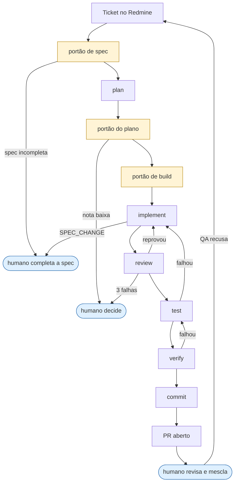

# Mapa de capacidades do Espectro

Comece por aqui. A página responde três perguntas: o que o Espectro faz, o que está ligado e
onde mora cada coisa. Cada capacidade tem uma página curta ao lado desta; o cabeçalho dela é a
fonte da tabela no fim.

## O que o Espectro faz

O Espectro transforma um ticket do Redmine em um pull request, com agentes de código no meio e
um humano nos pontos que contam. Um watcher busca os tickets e, a cada tick, despacha o próximo
nó de um grafo fixo: plan, implement, review, test, verify e commit. Entre os nós, portões
conferem o que o nó anterior deixou. O estado de cada Run fica num `state.json` com um só
escritor, e o consumidor é quem guarda dados, credenciais e histórico. O SQL de migração
num banco compartilhado só corre depois de uma aprovação humana no dashboard; o push e o PR
correm sob a autoridade do Attempt. O que está ligado hoje: o ciclo inteiro, o dashboard e o roteamento de
modelo como piloto; o diagnóstico de QA e o esforço por fase seguem desligados.

## Ciclo de uma Run

1. O watcher busca no Redmine os tickets elegíveis e reidrata as Runs que já existem.
2. A spec de ticket é gerada e validada. Spec incompleta não chega ao plan.
3. O Attempt é admitido e o roteamento escolhe o modelo, na admissão da Run.
4. O nó `plan` diagnostica e escolhe o contexto. O portão do plano dá nota e, se for baixa, refaz ou escala.
5. O portão de build confere que a base compila, e o nó `implement` muda o código.
6. O nó `review` revisa o diff em duas dimensões. Se reprova, volta ao `implement`, até 3 vezes.
7. O nó `test` roda os testes e grava a evidência de cada AC. Se falha, volta ao `implement`.
8. O nó `verify` confere a evidência contra a spec e, se a flag estiver ligada, a interface.
9. O nó `commit` abre o PR, em draft quando o risco é alto. O merge é humano.
10. Se o QA recusa o ticket, a recusa vira um ciclo próprio, que o dashboard reabre sobre a mesma Run.

Nó e portão são coisas diferentes: o nó é uma etapa do grafo, com agente; o portão é a conferência
que o watcher faz entre dois nós. Passou do limite de tentativas, a Run escala para o humano.

## Glossário

Um sentido por termo. Nesta pasta, "gate" só nomeia nível de revisão (G0–G3); a conferência do produto é "portão".

- **Espectro e Prisma**: Espectro é o nome do produto; Prisma é o nome antigo, que ficou no repositório, nas variáveis (`PRISMA_ROOT`) e nas issues (`PRI-*`).
- **consumidor**: o projeto que usa o Espectro e guarda a configuração, os dados, as credenciais e o estado autoritativo; o primeiro é o app-back.
- **Run**: uma execução do ciclo para um ticket, com um `state.json` próprio.
- **watcher**: o processo que, a cada tick, busca os tickets e despacha o próximo nó de cada Run (`scripts/readmine-watcher.js`).
- **tick**: uma passada do watcher, que roda, despacha o que for preciso e sai.
- **nó**: uma etapa do grafo, com um comando em `.claude/commands/` que é o prompt do agente.
- **portão**: a conferência que o watcher faz entre dois nós, como a nota do plano, o build e a evidência dos ACs.
- **gate (G0–G3)**: o nível de revisão de uma mudança no desenvolvimento do Espectro; G3 é a revisão por outro agente em contexto limpo.
- **spec de ticket**: o que entregar num ticket (`memory/spec/<ticket>-spec.md`, no consumidor); o plano diz como.
- **spec viva**: a página de uma capacidade que descreve o que ela faz hoje e é atualizada com a mudança; ainda não existe, é a fatia C2.
- **SPEC de fatia**: o documento de até duas páginas que descreve uma fatia do roadmap antes de ela começar; vale até o merge.
- **SDD**: desenvolvimento guiado por spec, o método em que a spec vem antes do código e é a fonte do que se entrega.
- **writer de SDD**: o módulo que controla versão e ativação de uma SDD por projeto; está congelado e nenhum código de produção o chama.
- **flag**: uma variável de ambiente que liga ou desliga um comportamento; comportamento novo entra com a flag desligada.
- **fatia**: a unidade de entrega do roadmap, de 3 a 5 dias, com ID estável (como `F1.2`), que termina em algo demonstrável.
- **AUTORIZO**: a palavra do Richard que libera uma ação que afeta o consumidor, como ligar uma flag ou subir o checkout; não é a aprovação do dashboard.
- **lease**: a marca que o watcher põe no nó em execução, para recuperar o nó que ficou órfão no tick seguinte.
- **Attempt**: uma tentativa de executar um nó, admitida com dono e snapshot presos; retry, timeout e resume abrem outro Attempt.

## Capacidades

<!-- capacidades:inicio -->
| Capacidade | Tipo | Situação | Spec | O que faz |
| -- | -- | -- | -- | -- |
| [autorizacao](autorizacao.md) | capacidade | ligada | sem-spec | Pedidos de autorização humana, aprovadores e a admissão do Attempt que autoriza efeito externo. |
| [ciclo-da-run](ciclo-da-run.md) | fluxo | ligada | sem-spec | O watcher, que a cada tick descobre os tickets, aplica os portões e despacha o próximo nó. |
| [config](config.md) | base | ligada | sem-spec | Confere a configuração do fluxo contra o contrato e o registro de flags contra o código. |
| [dashboard](dashboard.md) | fluxo | ligada | sem-spec | Painel local do Espectro, com Runs, custo, PRs, tickets, roteamento e pedidos de autorização, mais preview e checkout local. |
| [db-effect](db-effect.md) | capacidade | ligada | sem-spec | Executa, com aprovador humano, um SQL de migração num banco da allowlist e detecta mudança de schema. |
| [estado](estado.md) | base | ligada | sem-spec | Guarda o state.json de cada Run, com um só escritor, versão e lease de nó. |
| [execucao](execucao.md) | capacidade | ligada | sem-spec | Monta o contexto e a linha de comando do agente de cada nó e lê os sinais de saída dele. |
| [ferramentas](ferramentas.md) | capacidade | ligada | sem-spec | Scripts offline fora do caminho da Run, como demo, sondas, limpeza, exportadores, validadores de processo e o próprio mapa. |
| [grafo](grafo.md) | base | ligada | sem-spec | Define o ciclo da Run como grafo de nós, com o comando de cada nó e o limite de retry. |
| [integracoes](integracoes.md) | capacidade | ligada | sem-spec | Fala com o Redmine e o Bitbucket e avisa o dev por webhook, cobrindo ticket, anexos, PRs, horas e notificações. |
| [medicao](medicao.md) | capacidade | ligada | sem-spec | Mede e guarda o que as Runs deixam, como custo por nó, transcrições, comparação de Runs, padrões de falha e rastreio ticket → PR. |
| [portoes](portoes.md) | capacidade | ligada | sem-spec | Conferências entre nós do fluxo, como plano, build, churn, revisão, evidência dos ACs e UI. |
| [qa](qa.md) | capacidade | parcial | sem-spec | Trata a recusa de QA do Redmine, com ciclo próprio, devolução sem código e diagnóstico atrás de flag. |
| [roteamento](roteamento.md) | capacidade | parcial | sem-spec | Escolhe modelo e esforço por Attempt e decompõe o Implement em subtarefas, com política versionada. |
| [sdd-writer](sdd-writer.md) | capacidade | sem-chamador | sem-spec | Writer de SDD por projeto, que executa a consequência de uma Decision; congelado e sem chamador. |
| [spec](spec.md) | capacidade | ligada | sem-spec | Gera, valida, versiona e invalida a spec de cada ticket, que é a fonte dos critérios de aceite. |
<!-- capacidades:fim -->
