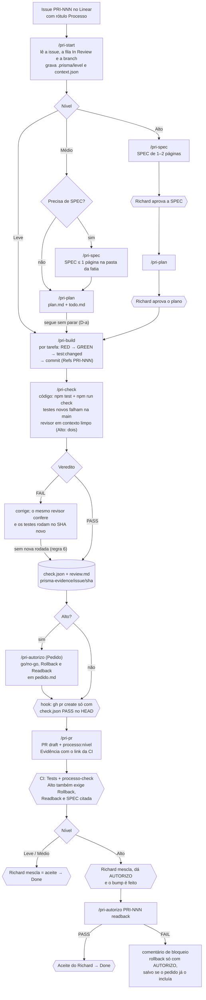

# Fluxo de desenvolvimento do Prisma

Diagrama do fluxo descrito no `CLAUDE.md` ("Fluxo de desenvolvimento"). As regras
ficam lá e nas skills `.claude/skills/pri-*`; se este desenho divergir delas, valem
as skills.

Os hexágonos são portões: decisão do Richard, hook ou CI. O hook só age numa sessão
de dev (com `.prisma/level`); a barreira real é a CI. No Médio, nada
para até o PR; no Alto, a SPEC e o plano param para aprovação antes do código.
